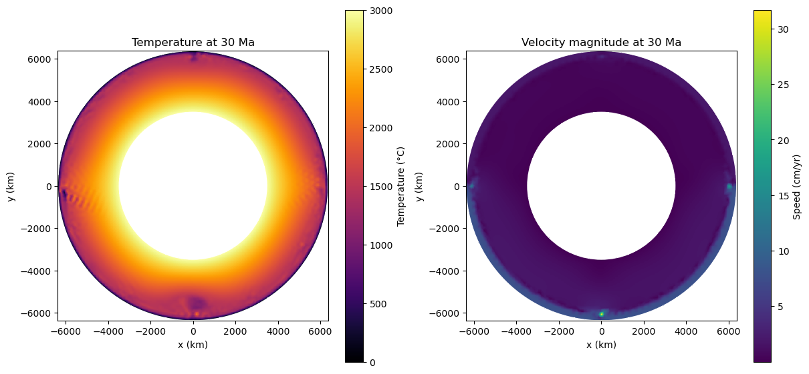
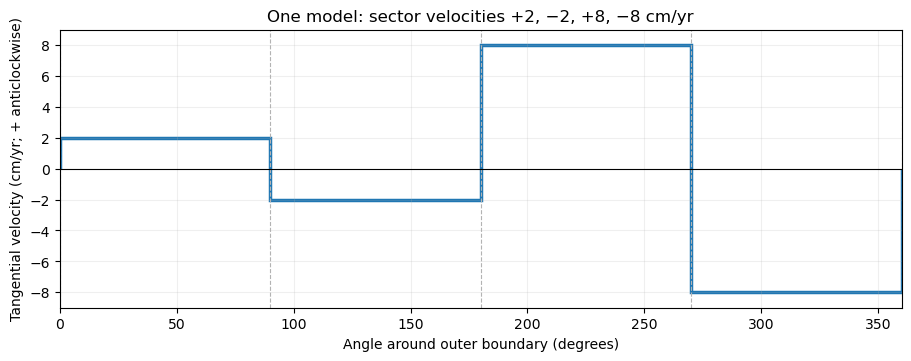
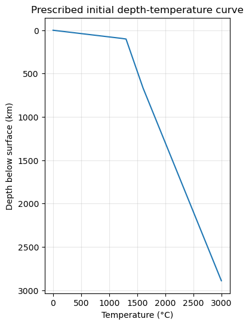

# From prompts to mantle flow

**Building an Underworld3 model with GPT-6 Luna on Linux**<br>
**Author:** @StuartRClark (GitHub)<br>
**AI assistant:** GPT-6 Luna<br>
**18 November 2026 · Draft technical note**

*This local worked example documents a prompt-driven modeling workflow. It is
written in the concise style of the Underworld Technical Notes, but is not an
official Underworld publication or a validated benchmark.*

## Abstract

This note records how GPT-6 Luna was used in a Linux environment to create,
run, inspect, and refine an Underworld3 mantle-convection notebook. It describes
the workstation and software environment, the official Underworld3 installation
route, the commands used to enter the Pixi runtime and start JupyterLab, and the
prompt iterations that turned an initial modeling request into a runnable
example. The accompanying notebook solves one 30 Ma annulus calculation with
Underworld3's native Navier–Stokes and advection–diffusion systems. The notebook,
three output figures, and a copy-ready final prompt are included. This is a
coarse test calculation for learning and reproducibility; it is not a
mesh-converged scientific result.

**Keywords:** GPT-6 Luna, prompt engineering, Underworld3, Linux, JupyterLab,
mantle convection, reproducible modeling

## 1. Purpose and workflow

The aim was to use prompts to produce a complete Underworld3 example rather
than a standalone conceptual description. The work proceeded through four
practical stages:

1. Define the mantle-annulus geometry, temperature profile, viscosity layers,
   boundary velocities, and desired 30 Ma run.
2. Clarify that momentum must be solved by Underworld3 at every timestep and
   temperature must then be advected and diffused.
3. Refine the boundary specification and figures so the notebook shows four
   discrete sector speeds and continuous-looking interpolated field plots.
4. Run the notebook, inspect its outputs and solver messages, and make the
   coarse-mesh GAMG choice explicit.

The result is an executed Jupyter notebook with its outputs saved in the file.
The technical note presents the system setup and prompt history, then records
the model equations, parameters, results, and limitations.

## 2. System and software used

The following is the environment snapshot for the Linux workspace used to
prepare and run the notebook. Hardware values are those reported by the guest
system and can differ from the physical host allocation.

| Component | Recorded configuration |
| --- | --- |
| AI workflow | GPT-6 Luna in the Codex desktop environment |
| Operating system | Ubuntu 26.04 LTS, x86_64, running in a VMware virtual machine |
| CPU reported by Linux | Intel Core Ultra 9 290HX Plus; 24 logical CPUs |
| Memory reported by Linux | 30 GiB RAM; 8 GiB swap |
| Underworld3 source | Checkout at `underworld3-runtime`, tag `v3.2.0` |
| Environment manager | Pixi, using the Underworld3 `runtime` environment |
| Python / JupyterLab | Python 3.12.12 / JupyterLab 4.5.1 |
| Underworld3 module version string | `0.0.0` as returned by `underworld3.__version__`; the source checkout is tagged `v3.2.0` |
| MPI run size | One rank |
| Environment features | Runtime visualization and notebook dependencies; no AMR build |

The Underworld3 `./uw` wrapper was used to select the project's Pixi runtime.
The notebook ran in that environment, so a separate system-wide Jupyter or
Python installation was not needed. The wrapper printed an advisory that the
Pixi lock file uses format v6; this did not prevent the notebook server or
simulation from running.

## 3. Installing, entering the runtime, and launching JupyterLab

### 3.1 Fresh Underworld3 installation

For a new Linux checkout, the [official Underworld3 Quick Install](https://underworld3.readthedocs.io/en/latest/beginner/installation.html)
recommends the `./uw` setup workflow:

```bash
git clone https://github.com/underworldcode/underworld3.git
cd underworld3
./uw setup
```

For this example, select **No AMR**, **Runtime**, and the platform-default MPI
when prompted, then allow the setup process to install dependencies and build
Underworld3. The Runtime environment includes JupyterLab and visualization
packages. The official guide describes other environment choices and
alternatives.

### 3.2 Opening the runtime for this example

For the run documented here, the Underworld3 checkout was in the
`underworld3-runtime` subdirectory beside the notebook. From the workspace
root, activate the runtime with:

```bash
./underworld3-runtime/uw shell
```

To start JupyterLab directly from that workspace root:

```bash
./underworld3-runtime/uw jupyter lab annulus_mantle_convection.ipynb
```

The target GitHub repository contains the notebook and output assets, not a
second copy of the full Underworld3 source checkout. If you clone this example
repository separately, install or locate Underworld3 in its own checkout and
launch the notebook by passing its path to that checkout's wrapper:

```bash
cd /path/to/underworld3
./uw shell
./uw jupyter lab /path/to/Underworld3_withChatGPT/annulus_mantle_convection.ipynb
```

The wrapper starts JupyterLab in the Pixi Runtime. If the default local port is
occupied, JupyterLab selects another available port; in the recorded session
it used port 8889. The notebook's Install section contains these two layouts.

## 4. Prompt development

Prompt refinement was driven by inspecting the notebook and clarifying which
parts of the request described physical boundary conditions, time integration,
and display choices. The excerpts below follow the order of the exchange.

| Stage | Prompt excerpt | What it changed |
| --- | --- | --- |
| Initial model request | “Build a python notebook (installing all prerequisites and setting up a notebook server) that installs and runs Underworld3 … an annulus mantle convection model … [with] a standard depth curve … layered viscosity … around 30 Ma.” | Established the model, installation workflow, and tables as one deliverable. |
| Time integration | “It seems like the stokes flow is run at each 10 Ma timestep but in reality we need to run the Navier Stokes solve from within UW3 itself and advect the temperatures.” | Required the native Underworld3 momentum solve and temperature transport at every timestep. |
| Surface boundary conditions | “The velocities vary across the surface smoothly. Rather they should have discrete velocities such that the divergence velocity and convergent velocity across the 4 boundaries around the circle are actually as specified.” | Clarified that prescribed boundary values should be discrete sectors, not a smooth angular velocity curve. |
| Speed interpretation and figures | “The ‘peak surface speed’ shows that two different models, whereas I imagined that the velocity should be 2cm/yr anticlockwise, 2cm/yr clockwise, 8 cm/yr anticlockwise, 8cm/yr clockwise. Make the displays continuous rather than hexagon.” | Made the four speeds one model, fixed the sign convention, and separated smooth field rendering from the discrete boundary profile. |
| Reusable prompt | “I would like a single prompt that would create the final output from the last model that I could share as a sample prompt for getting started with underworld3.” | Produced the copy-ready prompt in Section 7. |
| Solver message | After inspecting the run output, the coarse-mesh GAMG fallback was made explicit in the notebook. | Removed a misleading fallback warning without changing the solver choice or recorded model results. |

The key scientific distinction is between **sector speeds** and **relative
velocity jumps at sector junctions**. The selected sector speeds
`(+2, −2, +8, −8) cm/yr` do not produce uniform relative jumps of 2 and
8 cm/yr. Prompting made that consequence visible and the notebook reports the
actual signed jumps rather than implying both specifications were met.

The display request also needed a precise interpretation: the solved fields
are interpolated onto a fine plotting grid to remove the polygonal look, while
the surface-velocity plot remains a four-step profile so the prescribed values
stay visible. Plot interpolation changes no solved values and adds no mesh
resolution.

## 5. Model definition and numerical method

The model is a two-dimensional annulus with inner radius 3480 km, outer radius
6371 km, and mantle-thickness length scale 2891 km. Its outer boundary has
four 90° sectors with tangential velocities in increasing-angle order:

| Sector | Angular interval | Tangential speed |
| --- | --- | ---: |
| 1 | 0–90° | +2 cm/yr |
| 2 | 90–180° | −2 cm/yr |
| 3 | 180–270° | +8 cm/yr |
| 4 | 270–360° | −8 cm/yr |

Positive is anticlockwise and negative is clockwise. The outer boundary has
zero normal velocity; the inner boundary is no-slip. Temperature is fixed at
0°C at the surface and 3000°C at the CMB. The initial radial temperature
curve is piecewise linear through 0 km: 0°C, 100 km: 1300°C, 660 km: 1600°C,
and 2891 km: 3000°C. A 30°C four-lobed perturbation tapers to zero at the
radial boundaries.

| Model group | Parameter | Value |
| --- | --- | --- |
| Geometry | Inner / outer radius | 3480 / 6371 km |
| Geometry | Mantle thickness and length scale | 2891 km |
| Mesh | Target cell size / uniform refinement | 0.12 L / none; coarse test mesh |
| Fields | Velocity / pressure / temperature degree | 2 / 1 / 2 |
| Rheology | Reference viscosity | 10²¹ Pa·s |
| Rheology | Lithosphere, 0–100 km | 10²² Pa·s |
| Rheology | Asthenosphere, 100–660 km | 10¹⁹ Pa·s |
| Rheology | Lower mantle, 660–2891 km | 10²¹ Pa·s |
| Thermal | Diffusivity | 10⁻⁶ m²/s |
| Thermal | Temperature scale and boundary values | 3000°C; 0°C surface; 3000°C CMB |
| Thermal | Initial geotherm | 0 km: 0°C; 100 km: 1300°C; 660 km: 1600°C; 2891 km: 3000°C |
| Forcing | Rayleigh number / mantle density | 10⁴ / 3300 kg/m³ |
| Boundaries | Tangential sector speeds | +2, −2, +8, −8 cm/yr; positive anticlockwise |
| Run | Total duration / maximum step | 30 Ma / 0.5 Ma; 60 steps |
| Linear solver | Velocity preconditioner | GAMG, selected explicitly for the single-level mesh without a geometric hierarchy |

With length scaled by 2891 km, time by 1 Ma, viscosity by 10²¹ Pa·s, and
temperature by 3000°C, the velocity scale is 289.1 cm/yr, dimensionless
thermal diffusivity is 3.776 × 10⁻⁶, inertia coefficient is
8.740 × 10⁻¹⁹, and buoyancy coefficient `Ra·D` is 3.776 × 10⁻².

The nondimensional momentum equation uses a temperature anomaly relative to
the prescribed radial reference geotherm:

$$
\mathrm{Re}\left[\partial_t \mathbf{u} + (\mathbf{u}\cdot\nabla)\mathbf{u}\right]
- \nabla\cdot\left[2\eta\,\boldsymbol{\epsilon}(\mathbf{u})\right]
+ \nabla p
= \mathrm{Ra}\,D\,(T-T_{\mathrm{ref}})\,\hat{\mathbf{r}},
$$

$$
\nabla\cdot\mathbf{u}=0, \qquad
\partial_t T + \mathbf{u}\cdot\nabla T = D\nabla^2 T,
\qquad
\boldsymbol{\epsilon}(\mathbf{u})=
\tfrac12\left(\nabla\mathbf{u}+\nabla\mathbf{u}^{\mathsf T}\right).
$$

At each timestep, Underworld3's native `uw.systems.NavierStokes` solves
momentum from the current temperature, then `uw.systems.AdvDiffusion`
advects and diffuses temperature on the fixed mesh. The notebook uses the
Eulerian SUPG BDF2 advection–diffusion formulation and a maximum 0.5 Ma step.
For the single-level coarse mesh, it explicitly sets
`navier_stokes.preconditioner = "gamg"`. A refined production calculation
should build a geometric hierarchy (for example, with at least one uniform
refinement level) and use the automatic preconditioner; this example is not a
mesh- or timestep-convergence study.

The implied one-sided changes in tangential velocity, measured in the
increasing-angle direction, are:

| Junction | Incoming → outgoing | Signed jump |
| ---: | --- | ---: |
| 0° | −8 → +2 cm/yr | +10 cm/yr |
| 90° | +2 → −2 cm/yr | −4 cm/yr |
| 180° | −2 → +8 cm/yr | +10 cm/yr |
| 270° | +8 → −8 cm/yr | −16 cm/yr |

A continuous finite-element velocity field interpolates locally at each
shared junction, while sector interiors retain the prescribed velocities. If
the physical requirement is instead a uniform 2 or 8 cm/yr relative jump at
each selected boundary, the sector values must be redesigned.

## 6. Notebook outputs and run results

The complete executed notebook is the primary reproducibility artifact:

[Open `annulus_mantle_convection.ipynb`](annulus_mantle_convection.ipynb)

**Figure 1.** Temperature and velocity magnitude at 30 Ma. The solved nodal
fields are interpolated to a fine Cartesian plotting grid and masked to the
annulus. This smooths display only; it does not refine the finite-element
solution.



**Figure 2.** Four prescribed outer-boundary tangential speeds. The step plot
preserves the discrete sector values.



**Figure 3.** Piecewise-linear initial radial temperature curve.



The executed notebook reports Python 3.12.12, one MPI rank, and an Underworld3
module version string of `0.0.0`. Its source checkout is tagged `v3.2.0`. All
seven code cells execute, and the model advances 60 coupled steps to 30 Ma.
The recorded initial and final nodal statistics are:

| State | Time | T min | T mean | T max | Mean speed | Maximum speed over all velocity DOFs |
| --- | ---: | ---: | ---: | ---: | ---: | ---: |
| Initial | 0 Ma | 0°C | 1924.69°C | 3000°C | 0 cm/yr | 0 cm/yr |
| Final | 30 Ma | 0°C | 1914.65°C | 3000°C | 1.03 cm/yr | 32.584 cm/yr |

The 32.584 cm/yr value is the maximum over all velocity degrees of freedom
in the mantle domain, not a prescribed surface speed. The imposed sector
speeds peak at 8 cm/yr. The notebook labels these quantities separately.
The fine plotting grid makes the annulus maps visually continuous, but no
claim of spatial convergence is made.

## 7. Copy-ready prompt for reproducing the notebook

This prompt combines the final model request with the system and workflow
choices recorded above. Adjust the system description and runtime path when
using it on another machine.

````text
I am using GPT-6 Luna to create and run an Underworld3 mantle-convection
example in a Linux environment. For this run the system is Ubuntu 26.04 LTS,
x86_64, running in VMware, with 24 logical CPUs and 30 GiB RAM reported by the
guest. The existing Underworld3 source checkout is in `underworld3-runtime`
and is tagged v3.2.0. It has a Pixi `runtime` environment with Python 3.12.12
and JupyterLab 4.5.1. Use that runtime if present; do not install a second
system Python or Jupyter. On a fresh Linux system, use Underworld3's official
`./uw setup` workflow and choose No AMR, Runtime, and the platform-default MPI.

Create an annotated, executable notebook named
`annulus_mantle_convection.ipynb` and run all of its cells. Use Underworld3's
native APIs; do not substitute a toy solver or pseudocode. Start JupyterLab
through the checkout's `./uw jupyter lab` wrapper, and include concise setup,
activation, and launch instructions in the notebook.

Build one two-dimensional annulus mantle model with:

- Inner radius 3480 km; outer radius 6371 km; mantle thickness and length
  scale L = 2891 km.
- Four equal 90-degree outer-boundary sectors in increasing-angle order with
  tangential speeds +2, -2, +8, and -8 cm/yr. Positive is anticlockwise and
  negative is clockwise. These are four sectors of one model.
- Zero normal velocity at the outer boundary and no-slip velocity at the
  inner boundary. Explain how the continuous finite-element velocity field
  behaves at shared sector junctions.
- A piecewise-linear initial depth-temperature curve: 0 C at the surface,
  1300 C at 100 km, 1600 C at 660 km, and 3000 C at the CMB. Add a 30 C
  four-lobed perturbation that tapers to zero at the radial boundaries. Keep
  the outer thermal boundary at 0 C and the inner boundary at 3000 C.
- Viscosity of 1e22 Pa s from 0-100 km depth, 1e19 Pa s from 100-660 km,
  and 1e21 Pa s from 660-2891 km.
- Thermal diffusivity 1e-6 m2/s, mantle density 3300 kg/m3, and thermal
  Rayleigh number 1e4. Nondimensionalize with length 2891 km, time 1 Ma,
  viscosity 1e21 Pa s, and temperature 3000 C. Report the velocity scale,
  dimensionless diffusivity, Reynolds coefficient, and buoyancy coefficient.
- A coarse test mesh with target cell size 0.12 L and no uniform refinement.
  For this single-level mesh, set
  `navier_stokes.preconditioner = "gamg"` explicitly. Explain that a refined
  production mesh should have a geometric hierarchy and can use the automatic
  preconditioner.
- Underworld3's native `uw.systems.NavierStokes` solve at every timestep,
  followed by `uw.systems.AdvDiffusion` to advect and diffuse temperature on
  the fixed mesh. Run for 30 Ma with maximum 0.5 Ma steps (60 coupled steps).

Include readable tables for model parameters, governing equations, prescribed
junction velocity jumps, and initial and final states. Label the maximum
velocity statistic as the maximum over all velocity degrees of freedom, not
as a surface speed. The imposed sector peak speed is 8 cm/yr.

Calculate and show the one-sided tangential-velocity jumps at 0, 90, 180, and
270 degrees. For the sector speeds above they are +10, -4, +10, and -16 cm/yr.
Explain that these jumps follow from the sector values and do not equal a
uniform 2 or 8 cm/yr relative jump at every boundary.

Plot the 30 Ma temperature and velocity magnitude on annular maps. Interpolate
the solved fields onto a fine Cartesian grid for display so the maps look
continuous rather than polygonal; state clearly that this is display
interpolation and does not refine or alter the finite-element solution. Also
plot tangential surface velocity versus angle as a four-step profile so the
discrete sector speeds remain visible.

Execute the full 30 Ma test run and save notebook outputs. Report the actual
initial and final statistics from the run. Include the output figures and the
notebook file in the deliverables. Label the model as a coarse test example,
not a validated or converged mantle-convection benchmark. Record any warnings
and distinguish errors from non-fatal solver or environment messages.
````

## 8. Reproducibility, deliverables, and scope

The notebook is the executable record; this note explains the prompt workflow
and summarizes the saved outputs. The [complete note bundle](annulus_mantle_convection_note_bundle.zip) contains this note, the executed notebook, and the three PNG figures. To reproduce the run, install Underworld3 by
following the [official Quick Install](https://underworld3.readthedocs.io/en/latest/beginner/installation.html),
activate the Runtime environment, start JupyterLab with `./uw jupyter lab`,
and execute all cells. The [Eulerian Navier–Stokes guide](https://underworld3.readthedocs.io/en/latest/advanced/eulerian-navier-stokes.html),
[advection–diffusion guide](https://underworld3.readthedocs.io/en/latest/advanced/eulerian-advection-diffusion.html),
and [coupled convection tutorial](https://underworld3.readthedocs.io/en/latest/beginner/tutorials/8-Timestepping-coupled.html)
provide relevant API context.

The run is suitable as a prompt-engineering and notebook-structure example.
It is not a validated benchmark. A scientific study should resolve whether
surface-sector speeds or relative junction jumps are the intended boundary
conditions, then conduct mesh and timestep convergence checks. The Underworld
[Technical Notes series](https://www.underworldcode.org/notes/) and its
[submission guidance](https://www.underworldcode.org/submit/) describe the
format this local worked example takes as inspiration.
